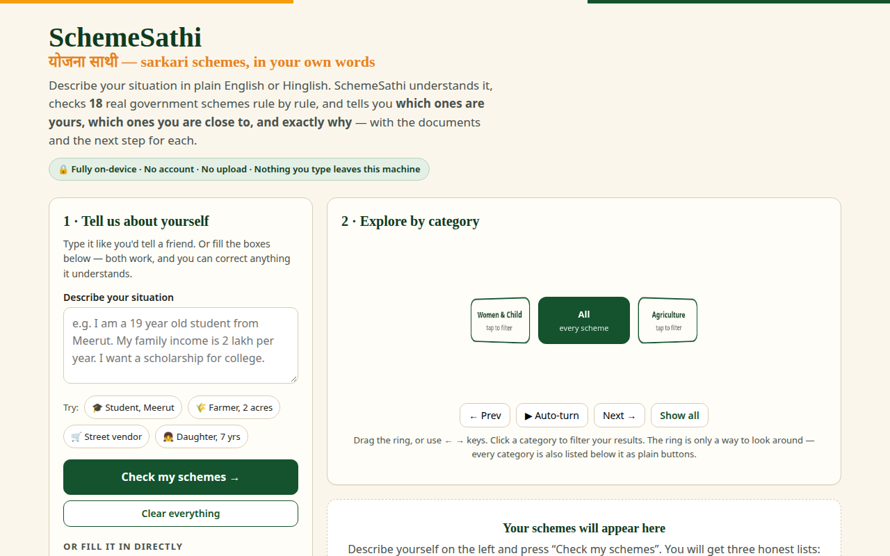
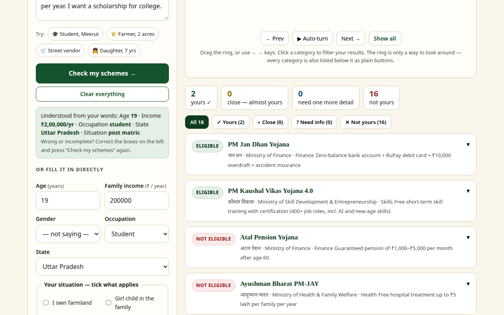

# SchemeSathi — which government schemes are actually yours

**Live app: https://schemesathi-kappa.vercel.app** · Demo video: https://www.youtube.com/watch?v=e0H6pNcQEhs

Type one line about your life — in English or Hinglish — and SchemeSathi checks 18 real government schemes rule by rule. It tells you which ones are yours, which ones you are close to, and exactly why the rest said no.

## Screenshots





## The problem

India runs hundreds of welfare schemes, and the people they exist for often never hear of them. The official portal lists 4,700+ schemes, but you have to fill structured forms in the portal's language, and a "no" comes with no reason. So eligible people miss money and support they are owed, simply because finding out was too hard.

## Who it is for, and who would pay

For first-time and Hindi-speaking applicants, and the families who apply on their behalf. It is free for them, and there is no login and nothing to upload.

The paying side is the helpers around them: CSC operators, NGOs and local agents who file applications for many people every week and need a fast, clear answer on who qualifies for what.

## What works today

- **One-line intake.** Describe your life in your own words ("main ek chhota dukaan chalata hoon, income 1.5 lakh hai") or use the structured form and correct anything it understood wrong.
- **18 real schemes, checked rule by rule.** Every scheme returns one of four plain verdicts — ELIGIBLE, CLOSE, NOT ELIGIBLE, NEEDS INFO — with the rule-by-rule reasons shown. A "close" tells you what would change the answer. Unknown is treated as a real answer, never a guessed yes or no.
- **What-if simulator.** Move the income and age sliders and watch the matches change live.
- **Documents and steps for every yes.** A checklist of documents and the application steps, ready to copy.
- **Four example personas** — student, farmer, street vendor, daughter — so anyone can see a full result in one click: the verdicts, the reasons, and the checklist, end to end.
- **Works offline.** No CDN, no webfonts, no external assets. Nothing leaves the device: the matching runs on-device, with no cloud model and no API key.

## The numbers

- 18 schemes, each checked rule by rule against your profile
- 42 automated tests, all passing — parser, matcher (eligible / close / hard-no / needs-info), what-if flips, trace completeness, and the frontend and routing suites
- 0 accounts, 0 uploads, 0 API keys

## How it works

1. An NLP layer reads plain English or Hinglish and builds a profile: age, income, gender, occupation, state, life situation. Lakh/crore and monthly figures are normalised.
2. A symbolic rules engine then checks every scheme against that profile and returns a trace for each rule, so every verdict can be explained in plain words.

The scheme figures are a curated snapshot as of November 2026. Amounts, income caps and age windows change, so the app says so on every screen and links each scheme to the official portal (https://www.myscheme.gov.in) to verify before applying. SchemeSathi is an independent project, not a government service; its verdicts are guidance, not an official decision.

## Run it

```bash
python3 run.py          # serves http://127.0.0.1:8765
```

Python 3.10+ standard library only — nothing to install. Set `SCHEMESATHI_PORT` to change the port.

Tests:

```bash
python3 -m pytest tests/ -q
```

## Where this can go

- More schemes and more languages, so the same one-line question works for more of India.
- A helper mode for CSC operators and NGOs: many profiles, one desk, printable checklists.
- A shorter path from "am I eligible?" to a filled application, with the official portal still the final step.

## Status and entries

Built solo by M S Abhishek. Live on Vercel and verified on 13 Nov 2026; the demo video was recorded from the live URL. Entered in SLAY Hacks 2026 (submitted 7 Nov 2026), GenHacks (12 Nov 2026), UKIS 2026, AI Kaushal, Tech4Bharat and INNOVATE INDIA. See `RELEASE_CARD.md` for the full build and QA record.
